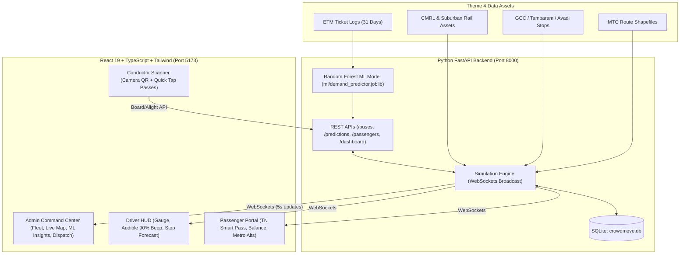

# SEERPAYANAM (TN-ITIS) — Tamil Nadu Intelligent Transit Management System
### AI-Powered Predictive Overcrowding, Demand-Supply Balancing & Multi-Modal Coordination System for Chennai (MTC, CMRL & SR)

> **Hackathon Theme 4 Submission**: Intelligent Public Transportation Management System using real Chennai Metropolitan Transport Corporation (MTC) Electronic Ticketing Machine (ETM) datasets, Shapefiles, and Metro/Suburban rail networks.

---

## 🚀 Executive Summary & Innovation

Conventional transit systems react *after* buses are overcrowded and bus bunching has already disrupted schedules. **TN-ITIS (Tamil Nadu Integrated Transit Intelligence System)** transforms reactive transit into a **proactive, machine-learning-driven operational command center**:

1. **Predictive Overcrowding**: Anticipates capacity violations 15–45 minutes in advance before buses arrive at critical stops.
2. **Real-time Occupancy & Driver Alerting**: High-contrast driver HUD with audible Web Audio beeps when operational capacity reaches $\ge 90\%$.
3. **Smart Passenger Card System (NFC/RFID + Digital QR)**: Government-backed transit card (ration-card style accessibility for citizens with or without smartphones) with live boarding/alighting validation, depot recharge, and turnstile REST APIs.
4. **Trained Machine Learning Models on Real Theme 4 Data**: Random Forest & Gradient Boosting Regressors trained on **480,000 sampled tickets from 31 daily CSV files (68M records, 3,080 buses, 1,487 directions)** of March 2026 MTC ETM logs, achieving an MAE of **9.12 passengers/stop** ($R^2 = 0.3282$).
5. **Bus Bunching Detection & Holding Response**: Real-time headway Coefficient of Variation ($CoV > 0.5$) tracking with automated holding recommendations to restore balanced intervals.
6. **Festival & Abnormal Demand Forecasting**: Pre-calibrated surge models for Pongal (2.5x), Deepavali (2.2x), Tamil New Year (1.8x), and Ayudha Pooja (1.9x) with one-click extra fleet surge recommendations.
7. **Multimodal Coordination**: Automatic suggestions for Chennai Metro Rail (Blue & Green lines) and Chennai Suburban Railway stations when bus routes reach saturation.

---

## 📊 Dataset Assets Used from `Theme 4`

| Data Asset | Source | Volume / Scale | Integration in System |
|---|---|---|---|
| **MTC ETM Ticket Logs** | `Theme 4/Theme 4/ETM/ETM/*.csv` | 31 CSV files, 68M tickets/month | Machine learning demand training, stage passenger load, peak hour profiles |
| **MTC Bus Routes & Corridors** | `Theme 4/Public Transport/MTC/routes_merged.shp` | 1,348 route geometries | Pilot corridors: Route 159 (804 pax/trip), 48C (Metro Feeder), 579C, 51X, 66, 114, 1C, 5B, 12G, 18A, 21H, M70 |
| **Greater Chennai Bus Stops** | `Theme 4/Tambaram, Avadi, GCC Bus Stops List 1.xlsx` | 2,720 official bus stops with coordinates | Realistic Chennai bus stops, stages, and GPS coordinate mapping |
| **Chennai Metro Rail (CMRL)** | `Theme 4/Public Transport/Metro Rail/` | Blue Line (31.6 km), Green Line (21.3 km), 40+ stations | Multimodal transfer recommendations & map overlay |
| **Chennai Suburban Railway** | `Theme 4/Public Transport/Suburban Rail/` | Beach-Tambaram, Beach-Arakkonam, Beach-Velachery | Alternative multimodal route suggestions |

---

## 🛠️ System Architecture



---

## 🤖 Machine Learning Model Architecture & Performance

### Features Used:
- `route_encoded`: Categorical encoding of MTC routes (Feature Weight: **33.97%**)
- `from_stage`: Discrete fare stage sequence along corridor (Feature Weight: **27.84%**)
- `hour`: Hour of the day, 0–23 (Feature Weight: **22.82%**)
- `day_of_week`: Monday (0) to Sunday (6) (Feature Weight: **12.17%**)
- `is_peak_hour`: Binary flag for 08:00–11:00 & 17:00–20:00 (Feature Weight: **2.74%**)
- `is_weekend`: Binary flag for Saturday & Sunday (Feature Weight: **0.45%**)

### Target Variable:
- $y = \text{total\_passengers}$ (Aggregated passenger boardings per route-hour-stage)

### Benchmark Comparison (80/20 Holdout Split):
| Model | MAE | RMSE | $R^2$ Score | Status |
|---|---|---|---|---|
| **RandomForestRegressor** (100 trees, depth 12) | **9.12 pax** | **14.84** | **0.3282** | **Selected Champion** |
| **GradientBoostingRegressor** (100 trees, depth 5) | **9.32 pax** | **15.12** | **0.3025** | Benchmark Baseline |

---

## ⚡ Quick Start Instructions

### 1. Backend Setup
```powershell
cd CrowdMove\backend
pip install -r requirements.txt
python seed.py               # Seeds 12 MTC corridors, 36 buses, 10 TN Smart Passes, Metro stations
python ml/train_models.py    # Trains ML model on Theme 4 ETM data
python -m uvicorn main:app --port 8000
```
*Backend runs on `http://localhost:8000` (API docs at `http://localhost:8000/docs`)*

### 2. Frontend Setup
```powershell
cd CrowdMove\frontend
npm.cmd install
npm.cmd run dev
```
*Frontend opens on `http://localhost:5173`*

---

## 🔑 Demo Accounts

| Role | Email | Password | Access URL |
|---|---|---|---|
| **Admin** | `admin@crowdmove.in` | `test123` | `http://localhost:5173` (Select Admin) |
| **Driver** | `rajesh@crowdmove.in` | `test123` | `http://localhost:5173` (Select Driver) |
| **Passenger** | `priya@gmail.com` | `test123` | `http://localhost:5173` (Select Passenger) |
| **Conductor** | - | - | Direct scanner at `http://localhost:5173/scanner` |

---

## 🎬 7-Step Hackathon Presentation Walkthrough

1. **Step 1: Passenger Experience & Smart Card**:
   - Open passenger view. Display the **Tamil Nadu Universal Smart Transit Pass** (`TN-MTC-2026-0001`) with QR code, ₹500 balance, and quick recharge.
2. **Step 2: Boarding & Occupancy Sync**:
   - Open `/scanner` in another tab. Click **"⚡ Priya (Pass 0001)"** or scan with camera.
   - Fare (₹10) deducted instantly; bus count increments; WebSockets immediately update all tabs.
3. **Step 3: Real-Time Occupancy & Driver HUD**:
   - Switch to the Driver view. The occupancy gauge animates.
   - When occupancy $\ge 90\%$, an **audible Web Audio beep** sounds and a flashing red warning banner informs the driver.
4. **Step 4: Machine Learning Overcrowding Prediction**:
   - Open Admin Dashboard. Click **"AI/ML Model & Data"** tab to show the trained Random Forest metrics ($R^2=0.3282$, MAE=9.12 pax) and interactive ML sandbox.
   - Go to **"Predictions"** tab: The model projects ahead which upcoming stop will trigger capacity violation (e.g. *Bus TN01-N-159-01 projected full at Stop 5 - M.G.R. Koyambedu*).
5. **Step 5: Proactive Bus Dispatch & Bunching Prevention**:
   - In **"Dispatch"** tab, system recommends: *"Deploy additional bus on Route 159"* and *"Hold TN01-N-159-01 for 3 mins to resolve bunching"*.
   - Click **"Dispatch Bus"**; standby bus from depot is immediately deployed onto the live map.
6. **Step 6: Festival Surge Intelligence**:
   - Switch to **"Festivals"** tab. Activate **"Pongal Festival"** (2.5x multiplier).
   - Real-time demand spikes across Koyambedu and Kilambakkam corridors with fleet surge allocation.
7. **Step 7: Multimodal Alternatives**:
   - Switch to Passenger tab -> **Live Buses**.
   - For crowded buses (orange/red), click **"Show nearby Metro/Rail"** -> shows Chennai Metro Green/Blue Line stations with walking distance (e.g. *CMBT Metro 0.4 km away, 5 min walk*).
